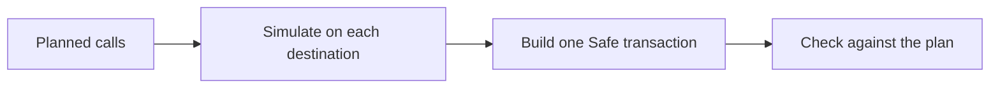

# @crossecute/sdk

Catch failing cross-chain operations before you ask Safe signers to approve them. The SDK simulates your calls on each destination with Foundry, packages them into one Safe transaction, and provides a CLI to check that the transaction matches the plan.

Install with `pnpm add @crossecute/sdk` or `npm install @crossecute/sdk`. Start with the [usage guide](docs/usage.md) or the [two-chain example](script/Example.s.sol).
