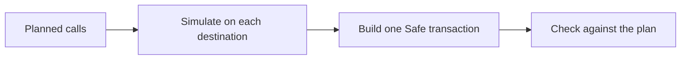

# @crossecute/sdk

Catch failing cross-chain operations before you ask Safe signers to approve them. The SDK simulates your calls on each destination with Foundry, packages them into one Safe transaction, and provides a CLI to check that the transaction matches the plan.



## Verify a sample Safe transaction

Save [plan.json](https://github.com/crossecute/sdk/blob/main/examples/verify-safe-tx/plan.json)
and [safe-tx.json](https://github.com/crossecute/sdk/blob/main/examples/verify-safe-tx/safe-tx.json)
in your project. With Node.js 22.12 or later, run:

```bash
npm install @crossecute/sdk
npm exec -- crossecute check plan.json safe-tx.json
```

With pnpm, use `pnpm add @crossecute/sdk` and `pnpm exec crossecute check plan.json safe-tx.json`.

The checked-in sample uses mock contracts. The check runs locally without a wallet or RPC.
It prints two batches for chain 10, the Safe nonce, and this hash:

```text
  safeTxHash:   0xfcd7d9a68b91d087117afdaeba293d343e2989dd8a94c98afa340113e2c88a90
```

[Build a transaction with Foundry](https://github.com/crossecute/sdk/blob/main/docs/usage.md#foundry) ·
[Full SDK guide](https://github.com/crossecute/sdk/blob/main/docs/usage.md)
